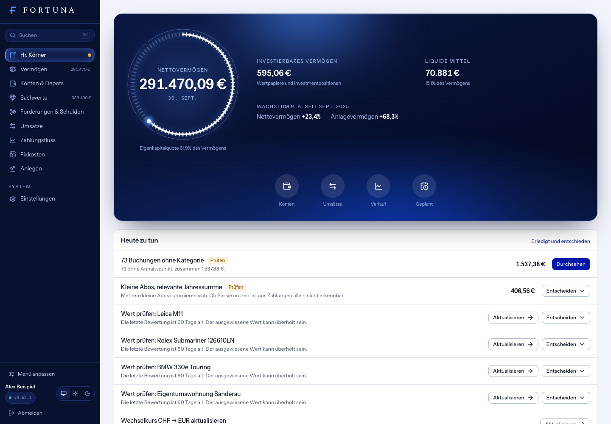

# Fortuna

Fortuna is a single-user personal finance application for tracking accounts, transactions, contracts, investments and net worth. It brings bank and broker data together with cashflow, recurring costs, assets and liabilities.

The built-in Copilot uses a connected ChatGPT account to answer questions and update supported records. Scalable orders require a provider preview and the owner's confirmation.



The screenshot uses a local demo dataset. See [preview setup](docs/screenshot-preview.md) for more screens.

Built with Bun, TanStack Start, React and PostgreSQL. Production runs on Vertex RKE2 with Fleet, Longhorn and Garage.

## Getting started

Requirements: Bun 1.4+, PostgreSQL 15+ (local or Docker).

```bash
bun install
cp .env.example .env            # fill DATABASE_URL, BETTER_AUTH_SECRET, OWNER_*
createdb fortuna_dev            # use this isolated local name in DATABASE_URL
bun run db:bootstrap:local      # first setup; historical files commit separately
bun run db:migrate              # applies migrations and creates the owner account
bun run db:seed                 # optional: 14 months of realistic demo data
bun run dev                     # http://localhost:3000
```

Sign in with `OWNER_EMAIL` / `OWNER_PASSWORD`. There is no sign-up page: the
owner account is the only way in, created by the migrator (or the seed) from
the environment.

The seed replaces demo-owner data and is restricted to local `fortuna_dev`,
`fortuna_test`, or `fortuna_demo_*` databases outside production. Use a disposable
database, fictional owner identity, and newly generated local secrets. Never
copy production configuration or bank/broker credentials.

### Environment variables

| Variable | Required | Purpose |
| --- | --- | --- |
| `DATABASE_URL` | yes | PostgreSQL connection string supplied through a runtime secret. |
| `BETTER_AUTH_SECRET` | yes | At least 32 random characters (`openssl rand -hex 32`). Signs sessions and derives the key that encrypts stored bank-provider secrets. Rotating it invalidates sessions and stored provider tokens. |
| `BETTER_AUTH_URL` | yes in production | Public base URL, e.g. `https://fortuna.example.com`. Used for cookies, trusted origins and MCP host validation. |
| `AUTH_TRUSTED_ORIGINS` | no | Comma-separated extra origins allowed to call the auth endpoints. |
| `OWNER_EMAIL`, `OWNER_PASSWORD`, `OWNER_NAME` | first deploy | Owner account created by `db:migrate` when it does not exist. Password: 12+ characters. |
| `MCP_BEARER_TOKEN` | no | Enables the read-only MCP endpoint at `/api/mcp` when set to 32+ random characters. |
| `OBJECT_STORAGE_ENDPOINT`, `OBJECT_STORAGE_REGION`, `OBJECT_STORAGE_BUCKET` | no | S3-compatible private storage for encrypted documents. If omitted, Fortuna keeps using the encrypted PostgreSQL fallback. |
| `OBJECT_STORAGE_ACCESS_KEY_ID`, `OBJECT_STORAGE_SECRET_ACCESS_KEY` | with object storage | S3-compatible credentials. Keep them server-side and inject them through runtime secrets. |
| `OBJECT_STORAGE_FORCE_PATH_STYLE` | no | Set to `true` only for S3-compatible providers that require path-style URLs. |
| `LOG_LEVEL` | no | `debug`, `info` (production default), `warn`, `error`. |
| `DATABASE_CONNECTION_TIMEOUT_MS`, `DATABASE_QUERY_TIMEOUT_MS` | no | Pool timeouts (defaults 5 s / 15 s). |

## Development

```sh
bun run dev
bun run verify
bun run test:integration
```

The integration suite uses PostgreSQL. See the [finance and data reference](docs/finance-reference.md), [Enable Banking](docs/integrations/enable-banking-sync.md), [Scalable](docs/integrations/scalable-capital.md) and [Copilot](docs/hr-koerner.md) guides.

## MCP

The endpoint is `/api/mcp`. Set `MCP_BEARER_TOKEN` for read-only access, or create a scoped token in Settings for supported writes. Bank credentials, Copilot and broker trading are not exposed through MCP.

## Deployment and recovery

CI publishes the image to GHCR; Fleet promotes its digest and runs database migrations in an init container. `/api/live` checks liveness and `/api/health` checks readiness. Keep `BETTER_AUTH_SECRET` with encrypted database backups: rotating it invalidates sessions and stored provider tokens.

`bun run db:seed` replaces demo-owner data. Use it only with a disposable local database.

## License

[All rights reserved](LICENSE). See [publication notes](docs/publication.md).
